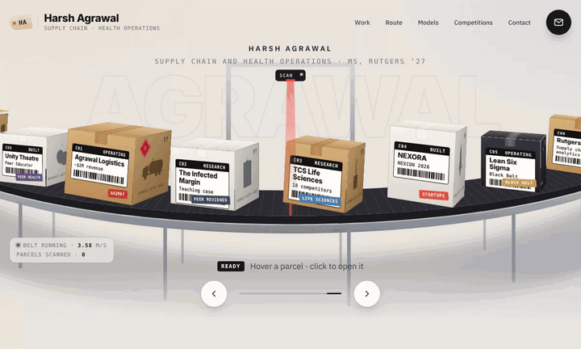
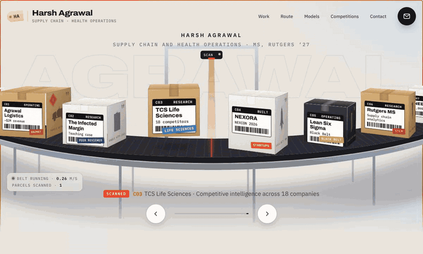
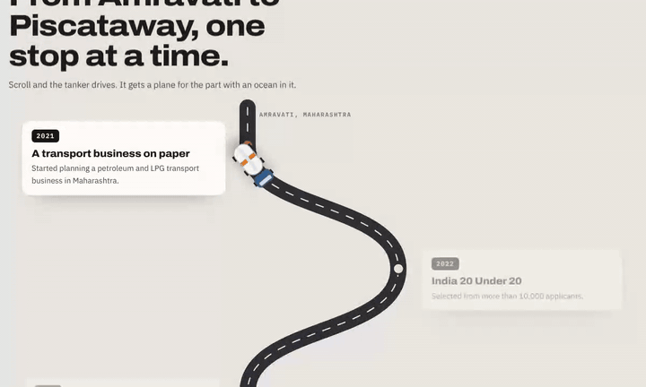
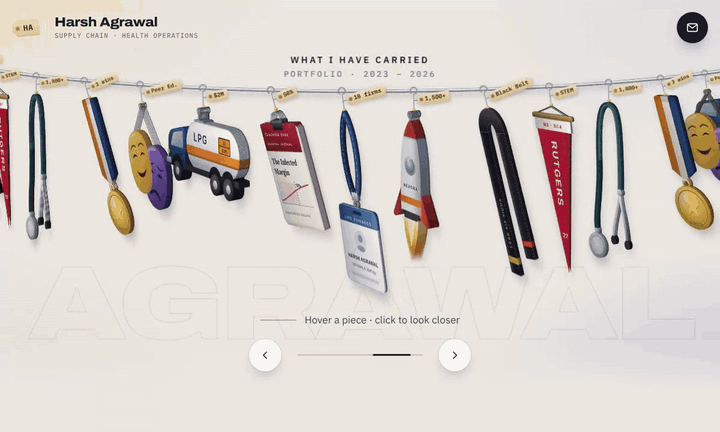

<p align="center">
  
</p>

<h1 align="center">Harsh's Website</h1>

<p align="center">
  <b>A Claude skill that stops your AI from building the same fade-in landing page.</b><br>
  It teaches the agent to pick one physical object from your subject's world, simulate it with real physics,<br>
  give it real thickness, and keep the page alive even when nobody touches it.
</p>

<p align="center">
  <a href="https://hsa70-ui.github.io/websiteskill/examples/conveyor-portfolio/"><b>Live demo: conveyor portfolio</b></a> ·
  <a href="https://hsa70-ui.github.io/websiteskill/examples/hanging-rail/"><b>Live demo: hanging rail</b></a> ·
  <a href="#install">Install</a> ·
  <a href="plugins/harshs-website/skills/harshs-website/SKILL.md">Read the skill</a>
</p>

<p align="center">
  
  
  
  
</p>

---

## Why this exists

Ask any AI to "make a beautiful website" and you get the same thing: a hero image, three feature cards, a testimonial strip, fade-ins on scroll and a hover lift. It looks fine and nobody remembers it.

The sites people actually remember do something else. One object from the subject's own world becomes the interface, and the page obeys physics around it. This skill is that thinking, written down so an agent can follow it every time:

> **Pick the object people would touch in the real version of this thing, then make the page obey physics around it.**

It came from taking a university merch store apart line by line (its products hang on a clothing rail that drifts, swings and turns to face you), rebuilding that motion twice for a real portfolio, and studying award-level interactive sites.

## See it

| A sortation line for a logistics operator | Open a parcel and its object rises out |
|---|---|
|  |  |
| **A road the truck drives as you scroll** | **The original idea: a rack that drifts and swings** |
|  |  |

Both demos are single HTML files with no framework and no animation library. Open them in a browser from the [`examples`](examples) folder.

## Install

### Claude Code: one command

```text
/plugin marketplace add hsa70-ui/websiteskill
/plugin install harshs-website@harshs-website
```

Or from your shell:

```bash
claude plugin marketplace add hsa70-ui/websiteskill
claude plugin install harshs-website@harshs-website
```

### Copy the skill folder

```bash
git clone https://github.com/hsa70-ui/websiteskill.git
cp -r websiteskill/plugins/harshs-website/skills/harshs-website ~/.claude/skills/
```

### Claude apps

Zip the [`plugins/harshs-website/skills/harshs-website`](plugins/harshs-website/skills/harshs-website) folder and add it as a custom skill.

### Other coding agents

The skill is plain Markdown. Paste [`SKILL.md`](plugins/harshs-website/skills/harshs-website/SKILL.md) into whatever instructions file your agent reads (for example `AGENTS.md` or a project rules file).

## Use it

Describe the site you want; the skill triggers on website, portfolio and landing-page work. In Claude Code you can also call it directly with `/harshs-website:harshs-website`.

```text
Design a landing page for my bakery. Make it feel like the real counter.
```
```text
Redesign my portfolio. I ran a logistics company and now study healthcare analytics.
```
```text
Look at <a site you love>, work out what makes its motion feel alive, then build something with that feel for my product.
```

The agent will name a signature object ("the page is a ___ and the visitor ___ it"), draw or source the objects, build the physics scene, give the objects thickness, echo the object below the fold, and verify that the page moves on its own before calling it done.

## What is inside the skill

| Section | What it gives the agent |
|---|---|
| Why the reference felt different | Ten traits that separate a memorable site from a stack of rectangles |
| Process | Eight steps, from reading a reference site properly to verification |
| Metaphor bank | 15 physical objects (conveyor, container crane, pill organiser, bookshelf, receipt printer, vinyl crate and more) with the physics each one needs |
| Reference sites | What to borrow from Bruno Simon, Lusion, Igloo Inc, Stripe Press, Poolsuite, Ableton Learning Synths, Teenage Engineering and others |
| Engine core | A vanilla JS loop: idle drift, damped springs, pendulum swing from acceleration, neighbour push, drag and fling |
| Thickness | Two ways to stop rotated objects looking like cardboard, plus a self-tuning quality fallback |
| Recipes | CSS cuboids, perspective surfaces, scanners as focal points, scroll as a physical input, in-page solvers |
| Verification | A Playwright routine that proves the scene moves with no input, on phone and desktop, in light and dark |
| Anti-patterns | Mistakes already paid for, so the agent does not repeat them |

## A taste of the metaphor bank

| Subject | Signature object | What the visitor does |
|---|---|---|
| Logistics | Conveyor belt of parcels | Parcels ride past a scanner; pick one up and it opens |
| Healthcare | Weekly pill organiser | Flick lids open; each compartment holds a project |
| Consulting | Deck of index cards | Throw cards; they keep the angle and speed you threw them with |
| Research | Bookshelf of spines | Pull a spine out; it turns to show the cover |
| Finance | Receipt printer | Scrolling prints the page line by line |
| Merch, clothing | Hanging rail | Pieces drift, swing and turn to face you |

## How the motion works

No timelines. Every object is a damped spring integrated every frame, and swing comes from the object's own acceleration, so it reacts to drags, flings and its neighbours the way a real object would.

```js
// turn toward the viewer, lift, and swing like a pendulum
t.yawV  += (k * (targetYaw - t.yaw) - v * t.yawV) * dt;  t.yaw  += t.yawV  * dt;
t.liftV += (k * (hovered - t.lift)  - v * t.liftV) * dt; t.lift += t.liftV * dt;
t.swingV += (-38 * t.swing - 2.4 * t.swingV + accel / length * 31.5 + breeze) * dt;
t.swing   = clamp(t.swing + t.swingV * dt, -16, 16);
```

The full engine, with the projection maths for a curved rail or belt, is in the skill.

## Built to be respectful

- `prefers-reduced-motion` turns drift and swing off and stiffens the springs.
- Every moving object is mirrored in a hidden keyboard list; arrow keys and Enter work on the scene.
- Touch devices get a centre-selection mode instead of hover.
- The loop pauses when the scene is off screen or the tab is hidden, and heavy thickness effects step down on slow devices.

## Credits

Mechanics were studied from the public frontend of the XLRI Prometheus Merch 2026 store. No assets, photos or branding were copied. Further inspiration from Bruno Simon, Lusion, Igloo Inc, Stripe Press, Poolsuite, Ableton Learning Synths, Teenage Engineering and Rauno Freiberg's essay "Invisible Details of Interaction Design".

Written by [Harsh Agrawal](https://www.linkedin.com/in/itshagrawal), with Claude.

## Contributing

New metaphors are the most useful contribution. Open a pull request that adds a row to the metaphor bank with the subject, the object, what the visitor does and the physics it needs, ideally with a small demo in `examples/`.

## License

[MIT](LICENSE). Use it for anything.
